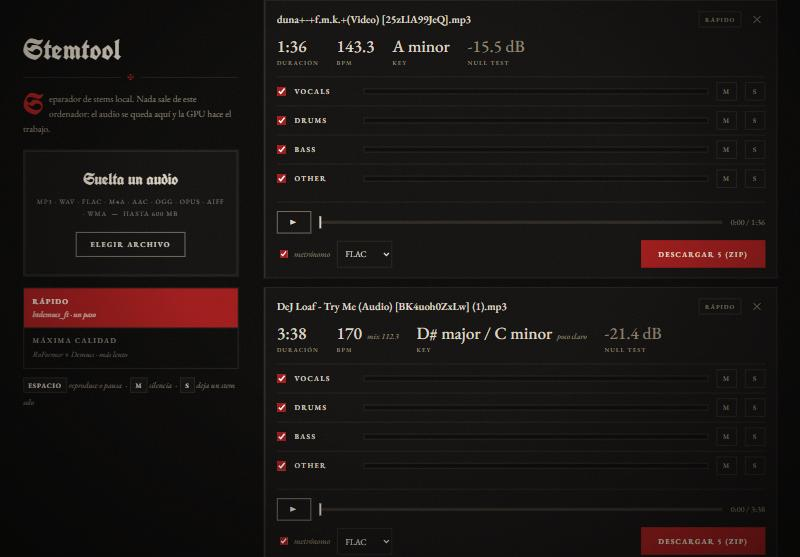

# stemtool

Separador de stems que corre entero en tu ordenador. Arrastras una canción, te
dice el BPM y la tonalidad en unos segundos, y la parte en voz, batería, bajo y
resto. Nada se sube a ningún sitio: el audio se queda en disco y la GPU hace el
trabajo.



## Cómo está hecho

Tres procesos y un reparto de tareas que no se cruza:

```
navegador  ──HTTP/SSE──>  servidor Node        ──JSON por stdin──>  worker Python
(UI, mezcla,              (cola, archivos,                          (torch, CUDA,
 reproductor)              descargas)                                librosa)
```

- **El servidor es `node:http` a pelo, cero dependencias de runtime.** Lo único
  que hay en `package.json` son TypeScript y los tipos de Node, y los dos son de
  desarrollo. Node 22 ejecuta los `.ts` directamente con
  `--experimental-strip-types`, así que tampoco hay bundler.
- **El worker de Python no muere entre canciones.** Cargar un checkpoint de
  RoFormer cuesta entre 5 y 20 segundos; con una cola, eso se pagaría en cada
  archivo. Arranca una vez y se queda leyendo líneas JSON de stdin.
- **El protocolo entre los dos es de cuatro verbos**: `prepare`, `analyze`,
  `analyze_stems`, `separate`. Todo lo caro vive detrás de esa frontera, y el
  servidor nunca importa torch ni sabe qué es un checkpoint.

## La parte que tiene miga

### El BPM se equivocaba de nivel métrico, no de tempo

Una canción de trap a 170 BPM salía como **113**. El detector no fallaba al
encontrar el pulso: fallaba al elegir a qué velocidad contarlo. 113 es 170×⅔, un
pulso que no toca nadie en la canción, ni el charles ni la caja.

El candidato correcto ya estaba en la lista y la evidencia ya lo ponía por
delante. Lo tumbaba un prior log-normal centrado en 120 BPM, demasiado estrecho:

| candidato | evidencia | prior (×120) | total |
|---|---|---|---|
| 113.0 | 0.565 | **0.99** | **0.559** ← ganaba |
| 169.4 | 0.647 | 0.70 | 0.459 |
| 84.7 | 0.663 | 0.70 | 0.467 |

Dos arreglos en `py/analyze.py`:

1. **La evidencia se lee del tempograma**, que mide la energía que hay *en* cada
   periodo de pulso. Antes se usaba la autocorrelación global medida en el
   periodo y en sus múltiplos (×1, ×2, ×4), y esa media premia a los tempos
   lentos: los múltiplos de un pulso lento caen en el compás y en la frase, que
   en música de loop son periódicos de sobra. El candidato lento cobraba una
   prima que el rápido no tenía cómo cobrar.
2. **El prior se ensancha a una octava de sigma**, con lo que vuelve a ser lo que
   debía ser: un desempate entre candidatos parejos, no quien decide.

Y un afinado: elegido el nivel, se ajusta una recta a los tiempos de los beats.
La pendiente promedia cientos de pulsos, así que el decimal significa algo
(170.0 en lugar de 169.4), y el corte da la fase — el segundo exacto en que cae
el primer beat.

### El metrónomo existe para delatar al BPM

Con cada descarga baja, si lo dejas marcado, una pista de clic. Va a **tempo
constante**, no pegada a los beats que encontró el detector, y eso es justo la
gracia: un metrónomo que persigue los beats suena bien aunque el número sea
falso, así que no comprueba nada. Este entra donde entra la música y sigue a
ritmo fijo, de modo que un BPM equivocado se despega solo y se oye.

Medido sobre una canción real de 3:38, proyectando la envolvente de la batería
sobre la frecuencia del clic: los golpes caen entre 9 y 13 ms del clic de
principio a fin, y la fase gira **1,8 ms** en toda la canción. Un error del 1 %
en el BPM habría dado dos segundos.

### Null test en cada separación

Al acabar, el worker suma los cuatro stems, le resta el mix original y mide lo
que queda. Si la separación es consistente, el residuo se hunde. Contra el
fixture sintético (`py/make_test_audio.py`, 120 BPM exactos, La menor):

| preset | modelos | null test |
|---|---|---|
| rápido | htdemucs_ft | −32.6 dB |
| máxima calidad | BS-RoFormer → htdemucs_ft | −31.6 dB |

Esa es la referencia: por encima de unos −25 dB conviene mirar qué pasó. No mide
si la separación *suena* bien, mide que no se ha perdido ni inventado señal por
el camino.

### Detalles de calidad que sí se notan

- **Se decodifica una vez y nunca se re-codifica.** La ingesta pasa el archivo a
  44,1 kHz sin pérdida y todo el pipeline parte de ahí. 44,1 porque es la
  frecuencia a la que se entrenaron los modelos, y el remuestreo va con soxr en
  calidad VHQ: un resampler barato mete aliasing que el modelo luego intenta
  separar como si fuera música.
- **`normalization_threshold` a 1.0.** Su valor por defecto (0.9) aplica *una
  ganancia distinta a cada stem*: rompe el balance relativo y, de paso, el null
  test.
- **`htdemucs_ft` son cuatro modelos, no uno.** Su receta es una matriz identidad
  que asigna un especialista a cada stem, y de ahí sale que cueste cuatro veces
  más que `htdemucs` a secas.

## Ejecutarlo

Hace falta Node 22 o superior, Python 3.12 con un entorno virtual en
`~/.venvs/stemtool`, una GPU NVIDIA con CUDA 12 y ffmpeg en el PATH.

```
npm install
npm run build        # web/app.ts -> web/dist/
npm start            # http://localhost:4747
```

El servidor escucha solo en `127.0.0.1`: es una herramienta, no un servicio. Al
arrancar se come unos diez segundos importando torch en segundo plano, a
propósito, para no pagarlos en la primera canción.

Los modelos se descargan solos la primera vez que usas cada preset y se quedan
en `~/.cache/stemtool-models` (htdemucs_ft ~320 MB, BS-RoFormer ~1 GB). El
intérprete de Python se busca en `~/.venvs/stemtool`, o en `STEMTOOL_PYTHON` si
lo tienes en otro sitio.

Comprobaciones que trae:

```
python py/analyze.py --demo fixture   # BPM y key contra el fixture sintético
python py/worker.py --selfcheck       # el clic cae donde dice que cae
npm run check                         # tipos, frontend y servidor
```

## Lo que no está validado

**La calidad de la separación.** El fixture sintético demuestra que el pipeline
cuadra, no que los stems suenen bien; para eso hace falta una canción real y
escucharla con atención. El null test detecta señal perdida o inventada, pero no
oye artefactos.

Tampoco hay tests automáticos más allá de los tres *self-checks* de arriba, ni
hace falta: es una herramienta de un solo usuario en un solo ordenador.

## Créditos

- Separación: [audio-separator](https://github.com/nomadkaraoke/python-audio-separator)
  sobre [Demucs](https://github.com/facebookresearch/demucs) (`htdemucs_ft`) y
  BS-RoFormer (`model_bs_roformer_ep_317_sdr_12.9755`).
- Análisis: [librosa](https://librosa.org) para onsets, cromagrama y tempo.
- Tonalidad: perfiles de **Temperley** (corpus Kostka-Payne) en lugar de
  Krumhansl-Kessler, que salió de experimentos sobre menor natural y confunde
  menor con mayor en cuanto suena una dominante con su sensible.
- Tipografía: [UnifrakturCook](https://fonts.google.com/specimen/UnifrakturCook)
  de j. 'mach' wust para los títulos y
  [EB Garamond](https://fonts.google.com/specimen/EB+Garamond) de Georg Duffner
  y Octavio Pardo para todo lo demás, las dos con SIL Open Font License 1.1
  (`web/fonts/OFL-unifrakturcook.txt`, `web/fonts/OFL-ebgaramond.txt`).

`PLAN.md` tiene el diario de diseño completo: qué se decidió, qué se midió y qué
se descartó.
